# secure-cloudrun-pipeline

A small, complete reference for shipping a containerized service to **Google Cloud Run** with security built into the delivery path: no stored credentials, signed images, least-privilege identities, automated checks, and everything defined as code.

The application is intentionally tiny (FastAPI, two endpoints). The point is the pipeline and infrastructure around it.

## How a change reaches production

```mermaid
flowchart LR
  pr["Pull request"] --> ci["CI: lint, tests, dependency audit,<br/>Dockerfile lint, secret scan"]
  ci --> main["Merge to main"]
  main --> oidc["GitHub OIDC token"]
  oidc --> wif["Workload Identity Federation"]
  wif --> sa["Deployer service account<br/>(short-lived credentials)"]
  sa --> build["Build image, push to<br/>Artifact Registry"]
  build --> sign["Sign image digest<br/>(cosign, keyless)"]
  sign --> deploy["Deploy that digest<br/>to Cloud Run"]
  deploy --> smoke["Smoke test /healthz"]
```



## What it demonstrates

| Practice | How it is done here |
|---|---|
| No long-lived credentials | Workload Identity Federation: GitHub's OIDC token is exchanged for short-lived Google credentials. There are no JSON keys and no secrets in the repository. Trust is limited to one repository and the `main` branch. |
| Least privilege | The runtime service account has **no roles**. The deployer can only push to one registry repository, update one Cloud Run service, and act as one runtime identity. |
| Supply-chain integrity | The image **digest** is signed with cosign (keyless) and Cloud Run is deployed **by digest**, so the running revision is exactly what was built and signed. |
| Shift-left checks | `ruff` (with bandit-style security rules), `pytest`, `pip-audit`, `hadolint` and `gitleaks`. The deploy job only runs if CI passes. |
| Hardened container | Multi-stage build, slim base image, non-root user, pinned dependencies. |
| Hardened application | Security headers on every response (including errors); interactive docs and OpenAPI schema disabled. |
| Controlled releases | `production` environment (add required reviewers in repo settings), one deploy at a time, smoke test after each deploy. |
| Infrastructure as code | Terraform provisions APIs, registry, identities, the federation trust and the service. |
| Dependency hygiene | Dependabot for pip, Docker, GitHub Actions and Terraform. |

## Repository layout

```
app/                    FastAPI service
tests/                  Unit tests (including security-header and no-docs checks)
Dockerfile              Multi-stage, non-root image
infra/                  Terraform for Google Cloud
.github/workflows/      ci.yml (reusable) and deploy.yml
.github/dependabot.yml  Automated dependency updates
docs/adr/               Architecture decision records
```

## Run it locally

```bash
python -m venv .venv && source .venv/bin/activate
pip install -r requirements-dev.txt
ruff check . && pytest -q
uvicorn app.main:app --reload
```

## Deploy it to your own project

Prerequisites: a Google Cloud project with billing enabled, `gcloud`, Terraform 1.6+, and a GitHub repository for this code.

1. **Provision the infrastructure**

   ```bash
   gcloud auth application-default login
   cd infra
   terraform init
   terraform apply -var project_id=YOUR_PROJECT_ID -var github_repository=OWNER/REPO
   ```

2. **Set repository variables** in GitHub under *Settings → Secrets and variables → Actions → Variables*. These are identifiers, not secrets:

   | Variable | Value |
   |---|---|
   | `GCP_PROJECT_ID` | your project ID |
   | `GCP_REGION` | region used in Terraform (default `us-central1`) |
   | `AR_REPOSITORY` | Terraform output `artifact_registry_repository` |
   | `CLOUD_RUN_SERVICE` | service name (default `secure-demo`) |
   | `WIF_PROVIDER` | Terraform output `wif_provider` |
   | `DEPLOYER_SA` | Terraform output `deployer_service_account` |

3. **Push to `main`.** The pipeline runs CI, builds, signs, deploys and smoke-tests.

To make the service private, apply with `-var allow_unauthenticated=false` and adjust the smoke test to send an identity token.

## Verify a deployed image

Check that an image was signed by this repository's deploy workflow:

```bash
cosign verify "REGION-docker.pkg.dev/PROJECT/app-images/app@sha256:DIGEST" \
  --certificate-identity-regexp "https://github.com/OWNER/REPO/.github/workflows/deploy.yml@refs/heads/main" \
  --certificate-oidc-issuer "https://token.actions.githubusercontent.com"
```

## Design decisions

See [ADR 0001: Keyless authentication and signed, digest-pinned deployments](docs/adr/0001-keyless-deploys.md).

## Hardening roadmap (not implemented here)

- Pin GitHub Actions to commit SHAs (Dependabot can keep them current).
- Add an image vulnerability gate (Trivy or Artifact Analysis) before deploy.
- Enforce signatures at deploy time with Binary Authorization.
- Generate an SBOM and provenance attestations.
- Put the service behind a load balancer with Cloud Armor and private ingress.
- Pin the base image by digest.

## License

MIT. See [LICENSE](LICENSE).
